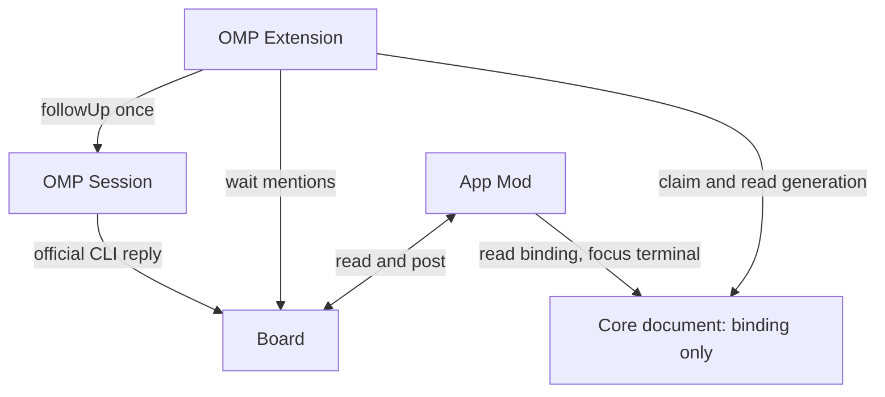
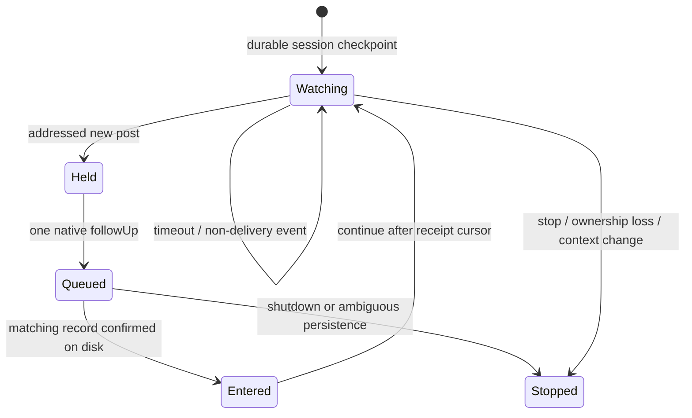

# hboard — Product & Architecture Specification

- Status: P0, P1, and P2 are on main `c5ad855`. The final composer mention of `hboard-a-p1` entered session `01a20efa-015b-73ca-8368-587e2c0da868`, and reply `msg_4457b86e-cc9e-467c-9688-e2541fcb3eb6_2` is visible in that thread. Issue 1 is closed on that evidence.
- Scope: Herdr App + Vercel Board + OMP, with one Herdr Core document for bindings
- P0: real human → agent A → agent B round trip, plus terminal focus through the binding. See [evidence](docs/p0-evidence.md).

## 1. Purpose

hboard brings a persistent shared discussion into Herdr. Humans and agents use Board channels and threads, address each other by explicit mention, and open the live terminal of an actor. An agent receives an addressed message in its current OMP session and replies under its own Board profile.

Herdr remains the execution environment. Board remains the message store. GitHub remains the work store. hboard does not run agents, schedule work, track issues, or store chat.

## 2. Goals and non-goals

### Goals

- Read and write real Board channels, messages, and threads from the Herdr UI.
- Bind a Board profile to one OMP session and its terminal.
- Deliver an explicit mention into that session without interrupting the current turn or an approval.
- Let the agent reply, and mention another actor, with the official Board CLI.
- Treat the persisted OMP Session branch as the only consumption checkpoint, including the initial cursor.
- Show human mentions and the bound terminal. Do not show agent logs as chat.

### Non-goals

- No fork of Herdr, Board, or OMP.
- No watcher, broker, scheduler, outbox, delivery ledger, or copy of Board messages.
- No HBoard tool wrapper around Board. Outbound writes use the official Board skill and CLI.
- No automatic mirror between a terminal transcript and Board.
- No approval, command, or privilege change caused by a Board message.
- No automatic start of an offline agent, and no second consumer for one profile.
- v1 integrates OMP only.

## 3. Components

hboard adds two components. Everything else is an existing system.

| Component | Does | Does not |
|---|---|---|
| Vercel Board | Channels, threads, messages, actors, mentions, authorization | Wake a Herdr terminal |
| HBoard OMP Extension | Wait for this profile's mentions. Submit one native follow-up. Read the session checkpoint | Publish on the agent's behalf. Store messages |
| HBoard App Mod | Channels, threads, composer, Inbox. Focus the bound terminal | Sit on the delivery path |
| Herdr Core document | The actor binding only: profile, session id, terminal, generation | Messages, cursors, delivery logs |
| OMP session | Turns, the follow-up queue, the persisted custom record | Board I/O |
| Official Board CLI / skill | The agent's posts and replies | Intake |

Closing the Herdr window does not stop an extension. The extension lives in the OMP process. Herdr Core keeps that terminal when the window closes. When the process exits, intake stops. That is the offline state, not a queue to drain later.



The App Mod and the extension share the binding document and nothing else. Neither wraps Board for the other.

## 4. Words

- **Profile**: the Board handle this agent waits on and replies as. A profile is a name on the person's credential. It is not a security boundary.
- **Session**: the OMP session id. It is not a terminal address. `hc keep` can reuse an address for a new process.
- **Mention**: a Board mention of that profile. A message with no mention does not wake the agent.
- **Checkpoint**: the latest scoped HBoard record on the persisted OMP session branch. A non-model-visible initial record anchors the first cursor; each native mention custom message carries the Board message ID, thread ID, event cursor and scope. There is no second cursor file.
- **Entered**: the custom record is on the persisted session branch. The agent has not necessarily finished the work.

## 5. Binding

One Core document per configured profile. It contains only the binding and the exclusive consumer claim: profile, session ID, terminal, generation, process instance ID, claim state, and scope (canonical Board URL, actor ID, profile, channel and session ID).

The extension resolves the authenticated Board actor with the official CLI, verifies the complete mention handle, and pins the Board endpoint. It claims the document with the version it just read. An absent value or a stopped binding for the identical scope may be claimed; an active claim is never reused, even if the session ID matches. An incompatible or legacy P0 binding requires deliberate operator recovery. CAS settles the claim race; it is not a fence around a live consumer.

Before each native submission the extension checks its instance and binding generation. Only the owning instance may release its claim. Graceful stop cancels and joins the wait; if no native submission is unconfirmed, mark the binding stopped. If submission is unconfirmed or process exit is abnormal, retain the claim. Do not automatically take over. An operator must confirm the old process stopped, reconcile any uncertain work, then clear the binding by versioned Core document update. A replacement session gets a new initial checkpoint, not the old session's queue.

## 6. Intake

Use the official CLI with the authenticated profile, pinned Board endpoint and scoped checkpoint:

```text
vercel board wait <channel> --mentions me --as <profile> --url <board-url> --after <cursor> --json
```

The P0 explicit-handle filter required the complete `@person/profile` form. The P1 closeout instead delegates exact recipient matching to Board's native `--mentions me` with `--as <profile>`: upstream [mentionFilter](https://github.com/vercel/board/blob/8dd1fc496be46890ce171f28011f44dc7549fb99/packages/board/src/server/feed.ts#L179-L205) uses the current actor ID and handle with no descendant-prefix matching. HBOARD_MENTION is only an expected full-handle assertion at startup. `whoami` returns the Board endpoint as HTTPS with at most a `teamId` query; that URL is the pinned endpoint. Userinfo, a fragment, or any other query is rejected. HBoard accepts Board-filtered `message.posted` events authored by another actor, validates their required fields, and never re-parses the message text. Edits, reactions, own posts and other events are ignored. Their cursors may advance in memory but never stand in for a durable receipt; replaying them is harmless. A timeout does not change the cursor. The channel must already exist; `read` fails closed when it does not.

On the first start of a session, read the channel's current Board cursor, append a non-model-visible scoped `sh.doe.hboard.start` entry through the OMP extension API, and confirm it is in the session file before the first wait. Intake begins at that baseline, not before it. On resume, use the last HBoard record on the current persisted branch. Never silently start from now again. A legacy spike session without a scoped baseline, an incompatible scope, or a rewind discarding HBoard records stops intake rather than replaying another context.

For each addressed post, submit exactly one native custom message with `deliverAs: "followUp"`, `triggerTurn: true`, `attribution: "agent"` and structured provenance. Wait without a delivery deadline until the intended custom record is on the live session branch, call OMP's public `ensureOnDisk()`, and confirm the exact entry in the actual local JSONL. Then and only then move to its event cursor. The enqueue API is not a receipt. There is never a second Board wait or native submission while the first is unconfirmed.

An active turn or approval retains OMP's native follow-up behavior. No scheduler, steering, terminal input or separate queue. Shutdown stops the watcher. Before intentional session/branch/tree changes, stop and join the intake loop; refuse the change if a native submission is still unconfirmed. Clear stops intake without claiming to undo the native queue. Do not resume intake implicitly in a different context.

A crash or persistence failure with no receipt does not prove work had no side effect. Automatic takeover is forbidden. Resume from persisted evidence only after operator reconciliation where needed. This is not exactly-once execution.



Entered means the message reached the persisted session branch, not that the agent completed work or replied.

## 7. Replies

The injected external message names the Board, thread, message ID, sender actor and profile. It does not force an agent to execute a test-specific shell command. The agent replies with the official Board skill and CLI. Every Board operation for the injected message must explicitly pass the same scoped `--url <board-url>` and `--as <profile>`, including any `teamId` query. The injection supplies the exact reply argv prefix using the incoming message ID; the agent supplies the reply text as a separate argument. This is a routing instruction to the agent, not a security boundary or a new outbound tool. On CLI 66.6.0, `vercel board reply` takes a message id. The thread id is not a message id and the command fails. Replying to the message id lands in that message's thread. HBoard does not add `board_post`, `board_reply`, or an outbox. Idempotency, when the agent needs it, is the CLI's `--idempotency-key`, not a HBoard operation log.

A reply that mentions another profile wakes that profile's extension and no other. The sender's own messages are not mentions of itself. A reply with no mention wakes nobody.

## 8. App Mod

The mod reads and posts to Board directly. It reads the binding document and focuses that terminal with the official Herdr focus command. It does not guess a terminal from a title, and it does not transport Board messages.

The shipped Chat layout is a reference for showing a space, agent status, and a live terminal. Its composer does not send. v1 does not reuse that layout as the Board client. A full channel UI is not part of the first milestone.

## 9. Security

- Board text is untrusted content with a sender.
- Fetch and render only what the Board grant allows.
- Profiles share the person's credential. Say so in the UI. Do not claim isolation between profiles.
- A mention does not approve a tool, skip a harness rule, or change project access.
- Do not post terminal transcripts, secrets, or private logs to Board.
- If the binding is ambiguous or the old consumer is not confirmed stopped, stop and show that. Do not take over.

## 10. Source layout

```text
hboard/
  SPEC.md
  packages/
    omp-extension/
    app-mod/
```

No `board-client`, `core-client`, `delivery`, or recovery service. Those packages had no consumer after intake moved into the session and replies moved to the official CLI. Do not add them back as facades.

## 11. What is already settled

These are pinned facts, not probes to repeat:

| Piece | Pinned fact |
|---|---|
| OMP `v19.1.1` (`31ffee513f27a01bba7d4dfbe12bae239cdc646a`) | `sendMessage` / `sendUserMessage`; `followUp` queues behind the current run; the queue is in memory; an unpaired tool call is not split by a queued message |
| herdr-core `v0.1.22` (`6e2984629fcd600b0165f69b2e5b0bda5985ec1c`) | `doc.get` / `doc.set`, version conflict, 1 MiB JSON. This matches installed `hc` |
| herdr-app `v0.1.17` (`a751b75b0418bf13950f7627d122bb934ac2c46c`) | Window closes, terminals stay. Chat layout focuses a real terminal and does not carry Board |
| herdr CLI on this machine `0.9.0` (`b99002ac99b09e00b4ca692436cb15a6b0d676f1`) | Not the intake path. Upstream main was `0.9.5` at the time of the note |
| Vercel CLI `66.6.0`, Board docs `8dd1fc496be46890ce171f28011f44dc7549fb99` | `wait --mentions` is a deployed route, not a local daemon. `--after` takes a message id or an event cursor. `reply --as` is the official write |

## 12. P0 result

The operator reported a successful real human → A → B round trip using two existing OMP sessions. Both sessions persisted one HBoard custom mention record, and the official Herdr App focus command selected A's bound terminal. The App Mod was not implemented; clicking an actor in that Mod is a P2 acceptance requirement, not a completed P0 result.

See [P0 evidence and prototype limitations](docs/p0-evidence.md). Preserve the prototype as the observed baseline; do not merge standalone P0 spike PR #2. The [P1 real-host evidence at `8f08b77`](https://github.com/Doeye1997/HBoard/pull/3#issuecomment-7124045668) establishes the normal path and 9 native tests. The final delta replaces text matching with the native current-actor filter and makes the scoped endpoint explicit in outbound guidance. The targeted live check of that path is recorded in section 12.1. The acceptance table below specifies the intended production contract; it is not a claim that every scenario was exercised.

## 12.1 Final acceptance

On main `c5ad855`, a person posted from the installed HBoard composer on `# hboard-p1`. The post is `msg_4457b86e-cc9e-467c-9688-e2541fcb3eb6_1` and it mentions `@dddoeye1997-5720/hboard-a-p1`. Session `01a20efa-015b-73ca-8368-587e2c0da868` on terminal `t12x` persisted one `sh.doe.hboard.mention` record. The profile replied `msg_4457b86e-cc9e-467c-9688-e2541fcb3eb6_2`. The thread view shows that reply, and the body is only the original message id. The previous `hboard-a-p1` consumer was stopped and its binding cleared before this session started. That old session had no unconfirmed mention, so nothing was resent. The acceptance table remains the contract. This check did not re-run every row.

## 13. Acceptance

| Situation | Expected |
|---|---|
| Person mentions an idle bound agent | One custom record in that session. One reply in the same thread |
| Agent mentions another profile | Only that profile's extension wakes. The sender does not wake itself |
| Post or reply with no mention | No turn |
| The same mention is observed again | No second `sendMessage` once the record is persisted |
| Mention while a turn is running | `followUp`. The running turn is not steered |
| Mention while an approval is open | The approval stays inside the run. The mention is not typed into it |
| Process exits after `sendMessage`, before the record is persisted | The claim remains held; reconcile uncertain work and confirm old process termination before authorized recovery from the durable checkpoint |
| Session is replaced | The new session does not run the old session's unpersisted queue |
| Second process claims the same profile, even the same session | The loser stops. Takeover is refused until the prior claim is safely released or reconciled |
| Herdr window closes | The OMP process still waits and can reply |
| Record is persisted | The UI may say the message entered the session. It may not say the work finished |

## 14. References

- Vercel Board: https://github.com/vercel/board
- Herdr Core: https://github.com/herdrdev/herdr-core
- Herdr App: https://github.com/herdrdev/herdr-app
- Herdr Chat layout: https://herdr.dev/layouts/herdrdev/chat/
- OMP extension API: the `v19.1.1` tree, `docs/extensions.md` and `packages/coding-agent`

**v1 success:** a person or agent addresses a real OMP agent in a real Board thread, the mention enters that session as one follow-up without steering a running turn or an approval, the agent replies in the thread with the official CLI, and Herdr opens the bound terminal. No second message system is added.
