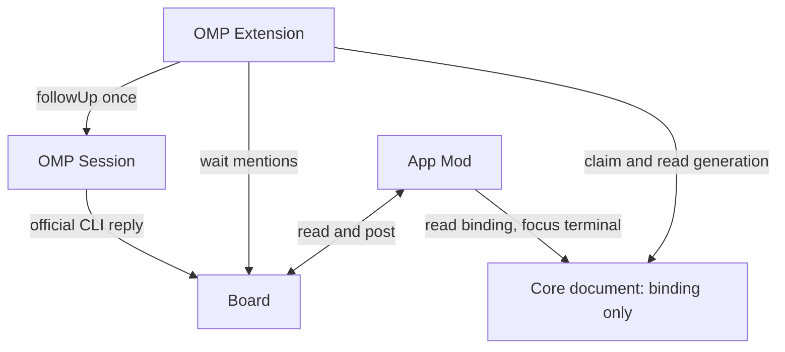
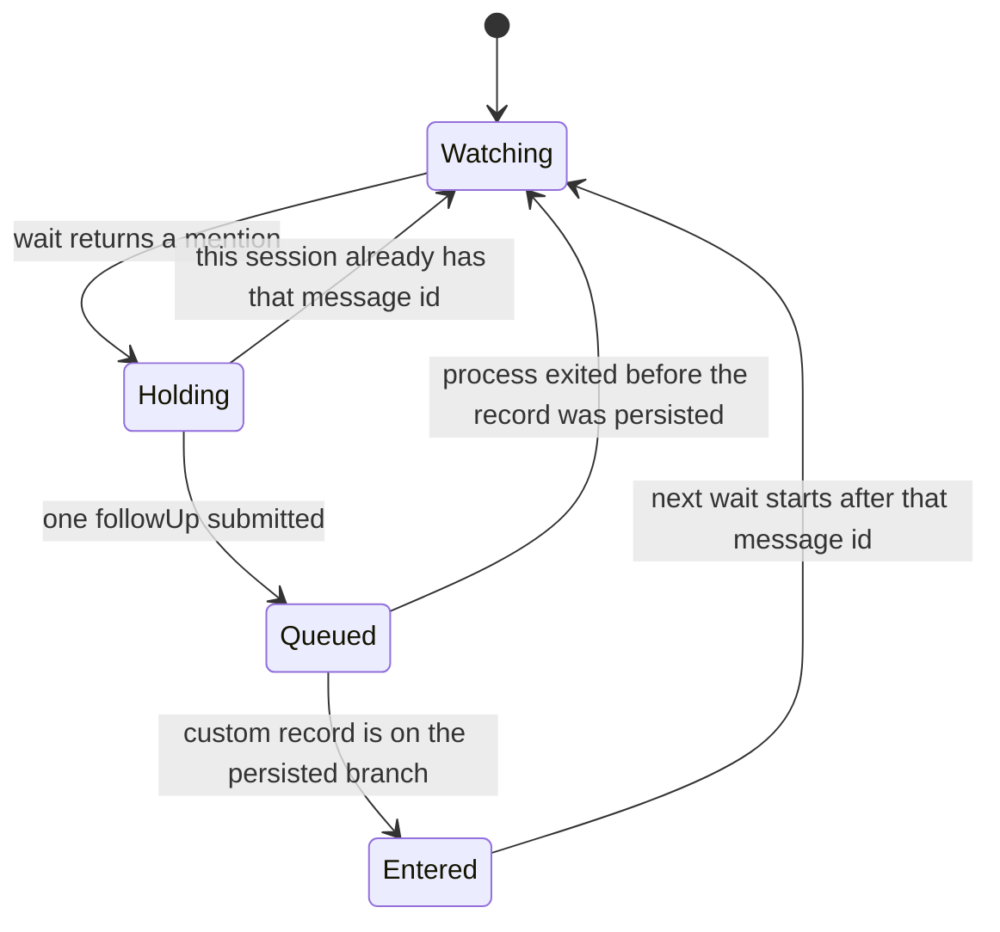

# hboard — Product & Architecture Specification

- Status: P0 normal-path integration reported successful; P1 production hardening and App Mod remain open
- Scope: Herdr App + Vercel Board + OMP, with one Herdr Core document for bindings
- P0: real human → agent A → agent B round trip, plus terminal focus through the binding. See [evidence](docs/p0-evidence.md).

## 1. Purpose

hboard brings a persistent shared discussion into Herdr. Humans and agents use Board channels and threads, address each other by explicit mention, and open the live terminal of an actor. An agent receives an addressed message in its current OMP session and replies under its own Board profile.

Herdr remains the execution environment. Board remains the message store. GitHub remains the work store. hboard does not run agents, schedule work, track issues, or store chat.

## 2. Goals and non-goals

### Goals

- Read and write real Board channels, messages, and threads from the Herdr UI.
- Bind a Board profile to one OMP session and its terminal.
- Deliver an explicit mention into that session without interrupting the current turn or an approval.
- Let the agent reply, and mention another actor, with the official Board CLI.
- Treat the persisted OMP custom record as the only consumption checkpoint.
- Show human mentions and the bound terminal. Do not show agent logs as chat.

### Non-goals

- No fork of Herdr, Board, or OMP.
- No watcher, broker, scheduler, outbox, delivery ledger, or copy of Board messages.
- No HBoard tool wrapper around Board. Outbound writes use the official Board skill and CLI.
- No automatic mirror between a terminal transcript and Board.
- No approval, command, or privilege change caused by a Board message.
- No automatic start of an offline agent, and no second consumer for one profile.
- v1 integrates OMP only.

## 3. Components

hboard adds two components. Everything else is an existing system.

| Component | Does | Does not |
|---|---|---|
| Vercel Board | Channels, threads, messages, actors, mentions, authorization | Wake a Herdr terminal |
| HBoard OMP Extension | Wait for this profile's mentions. Submit one native follow-up. Read the session checkpoint | Publish on the agent's behalf. Store messages |
| HBoard App Mod | Channels, threads, composer, Inbox. Focus the bound terminal | Sit on the delivery path |
| Herdr Core document | The actor binding only: profile, session id, terminal, generation | Messages, cursors, delivery logs |
| OMP session | Turns, the follow-up queue, the persisted custom record | Board I/O |
| Official Board CLI / skill | The agent's posts and replies | Intake |

Closing the Herdr window does not stop an extension. The extension lives in the OMP process. Herdr Core keeps that terminal when the window closes. When the process exits, intake stops. That is the offline state, not a queue to drain later.



The App Mod and the extension share the binding document and nothing else. Neither wraps Board for the other.

## 4. Words

- **Profile**: the Board handle this agent waits on and replies as. A profile is a name on the person's credential. It is not a security boundary.
- **Session**: the OMP session id. It is not a terminal address. `hc keep` can reuse an address for a new process.
- **Mention**: a Board mention of that profile. A message with no mention does not wake the agent.
- **Checkpoint**: the custom record in the session's persisted branch. It stores the Board message id, thread id, and the cursor used to wait. There is no second cursor file.
- **Entered**: the custom record is on the persisted session branch. The agent has not necessarily finished the work.

## 5. Binding

One Core document per profile:

```json
{ "profile": "@agent-a", "sessionId": "…", "terminal": "t…", "generation": 1 }
```

The extension claims it with `doc.set` and the version it just read. If the version conflicts, this process stops waiting. The winner is the only waiter.

A generation check does not stop a process that has already decided to call `sendMessage`. v1 therefore does not migrate a binding while the old consumer might still be running. Move the binding only after that process is confirmed stopped. If that cannot be confirmed, refuse the takeover. The compare-and-swap settles the claim race. It is not a fence around a live consumer.

A replaced session does not inherit the old session's unpersisted messages. The new extension starts from Board at its own checkpoint, or from "now" when it has none. It does not replay another session's queue.

## 6. Intake

The extension, and only the extension, runs:

```text
vercel board wait <channel> --mentions @<person>/<profile> --after <cursor> --json
```

The handle needs the `@` and the person's prefix. On CLI 66.6.0, `--mentions hboard-a` and the actor id did not match a live mention; `--mentions @dddoeye1997-5720/hboard-a` did. Board stores that mention in the text as `@[actor-id]`. `--after` accepts a Board message id or an event cursor. The cursor for the next wait is the cursor on the last custom record in the live session branch. A new session with no record starts at the current head, so older mentions are not submitted.

For each returned mention:

1. If the live session branch already has a custom record for that Board message id, do not call `sendMessage`. The record is the checkpoint. Continue the wait after it.
2. Otherwise call `pi.sendMessage` once, with `deliverAs: "followUp"`, `triggerTurn: true`, `attribution: "agent"`, and a HBoard `customType`. `details` carries the Board message id, thread id, the cursor, and the sender. The text is untrusted user content, not a system instruction.
3. Do not call `sendMessage` again for that message id until this attempt is known. The follow-up queue is an in-memory array. The call's Promise is not a durable receipt.
4. Advance the wait only when that custom record is on the persisted session branch. If the process dies before that, the queue is gone and the next wait returns the same mention.

`followUp` queues behind the current run. The default `steer` is not used, because it changes a running turn. An approval stays inside the run: streaming stays set until the run ends, and a queued follow-up is not inserted between a tool call and its result. HBoard does not detect approvals itself and does not add a scheduler.

Entered means the record is in the session. It does not mean the model finished, replied, or succeeded.



This diagram is only the extension's gap between Board and the session file. Board's log and OMP's run are not these states.

## 7. Replies

The injected message names the thread, the message id, and the profile. The agent replies with the official Board skill and CLI, including `--as <profile>` when the post must use that profile. On CLI 66.6.0, `vercel board reply` takes a message id. The thread id is not a message id and the command fails. Replying to the message id lands in that message's thread. HBoard does not add `board_post`, `board_reply`, or an outbox. Idempotency, when the agent needs it, is the CLI's `--idempotency-key`, not a HBoard operation log.

A reply that mentions another profile wakes that profile's extension and no other. The sender's own messages are not mentions of itself. A reply with no mention wakes nobody.

## 8. App Mod

The mod reads and posts to Board directly. It reads the binding document and focuses that terminal with the official Herdr focus command. It does not guess a terminal from a title, and it does not transport Board messages.

The shipped Chat layout is a reference for showing a space, agent status, and a live terminal. Its composer does not send. v1 does not reuse that layout as the Board client. A full channel UI is not part of the first milestone.

## 9. Security

- Board text is untrusted content with a sender.
- Fetch and render only what the Board grant allows.
- Profiles share the person's credential. Say so in the UI. Do not claim isolation between profiles.
- A mention does not approve a tool, skip a harness rule, or change project access.
- Do not post terminal transcripts, secrets, or private logs to Board.
- If the binding is ambiguous or the old consumer is not confirmed stopped, stop and show that. Do not take over.

## 10. Source layout

```text
hboard/
  SPEC.md
  packages/
    omp-extension/
    app-mod/
```

No `board-client`, `core-client`, `delivery`, or recovery service. Those packages had no consumer after intake moved into the session and replies moved to the official CLI. Do not add them back as facades.

## 11. What is already settled

These are pinned facts, not probes to repeat:

| Piece | Pinned fact |
|---|---|
| OMP `v19.1.1` (`31ffee513f27a01bba7d4dfbe12bae239cdc646a`) | `sendMessage` / `sendUserMessage`; `followUp` queues behind the current run; the queue is in memory; an unpaired tool call is not split by a queued message |
| herdr-core `v0.1.22` (`6e2984629fcd600b0165f69b2e5b0bda5985ec1c`) | `doc.get` / `doc.set`, version conflict, 1 MiB JSON. This matches installed `hc` |
| herdr-app `v0.1.17` (`a751b75b0418bf13950f7627d122bb934ac2c46c`) | Window closes, terminals stay. Chat layout focuses a real terminal and does not carry Board |
| herdr CLI on this machine `0.9.0` (`b99002ac99b09e00b4ca692436cb15a6b0d676f1`) | Not the intake path. Upstream main was `0.9.5` at the time of the note |
| Vercel CLI `66.6.0`, Board docs `8dd1fc496be46890ce171f28011f44dc7549fb99` | `wait --mentions` is a deployed route, not a local daemon. `--after` takes a message id or an event cursor. `reply --as` is the official write |

## 12. P0 result

The operator reported a successful real human → A → B round trip using two existing OMP sessions. Both sessions persisted one HBoard custom mention record, and the official Herdr App focus command selected A's bound terminal. The App Mod was not implemented; clicking an actor in that Mod is a P2 acceptance requirement, not a completed P0 result.

See [P0 evidence and prototype limitations](docs/p0-evidence.md). Preserve the prototype as the observed baseline. The acceptance table below specifies the intended production contract; it is not a claim that every scenario passed P0.

## 13. Acceptance

| Situation | Expected |
|---|---|
| Person mentions an idle bound agent | One custom record in that session. One reply in the same thread |
| Agent mentions another profile | Only that profile's extension wakes. The sender does not wake itself |
| Post or reply with no mention | No turn |
| The same mention is observed again | No second `sendMessage` once the record is persisted |
| Mention while a turn is running | `followUp`. The running turn is not steered |
| Mention while an approval is open | The approval stays inside the run. The mention is not typed into it |
| Process exits after `sendMessage`, before the record is persisted | The next wait can see the mention again. It is submitted once |
| Session is replaced | The new session does not run the old session's unpersisted queue |
| Second process claims the same profile | The loser stops. Takeover is refused until the winner is confirmed stopped |
| Herdr window closes | The OMP process still waits and can reply |
| Record is persisted | The UI may say the message entered the session. It may not say the work finished |

## 14. References

- Vercel Board: https://github.com/vercel/board
- Herdr Core: https://github.com/herdrdev/herdr-core
- Herdr App: https://github.com/herdrdev/herdr-app
- Herdr Chat layout: https://herdr.dev/layouts/herdrdev/chat/
- OMP extension API: the `v19.1.1` tree, `docs/extensions.md` and `packages/coding-agent`

**v1 success:** a person or agent addresses a real OMP agent in a real Board thread, the mention enters that session as one follow-up without steering a running turn or an approval, the agent replies in the thread with the official CLI, and Herdr opens the bound terminal. No second message system is added.
