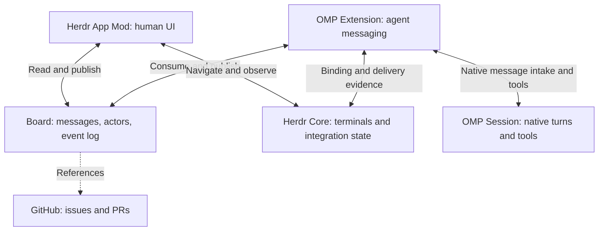
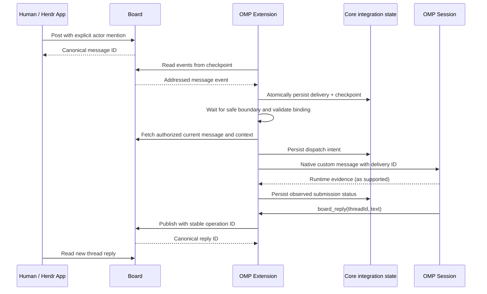
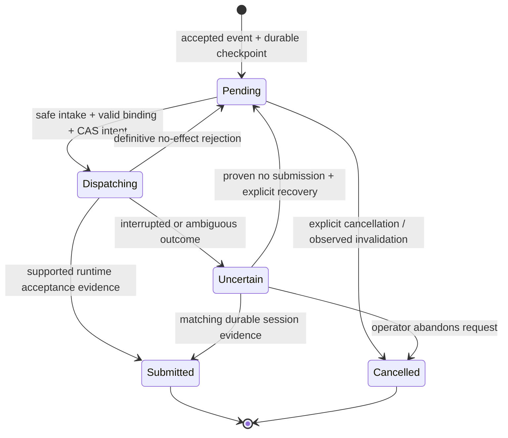

# hboard — Product & Architecture Specification

- Status: Draft / architecture review required
- Scope: Herdr Core + Herdr App + Vercel Board + OMP
- Initial milestone: prove the end-to-end message interaction on real services

## 1. Purpose

hboard brings a persistent shared discussion workspace into Herdr. Humans and agents can participate in Board channels and threads, explicitly address each other, and navigate from discussions to live Herdr terminals. An agent can receive a relevant external message without losing its current session, and publish a reply under its own Board identity.

Herdr remains the execution environment. Board remains the communication source of truth. GitHub remains the task and delivery source of truth. hboard is an integration, not another agent runtime, scheduler, issue tracker, or chat server.

## 2. Goals and non-goals

### Goals

- Read and write real Board channels, messages, and threads from the Herdr UI.
- Associate Board actors with real Herdr terminals and OMP sessions.
- Deliver explicitly addressed messages into the correct OMP session at a safe boundary.
- Allow an agent to read thread context, post, reply, and address other actors.
- Retain evidence of delivery across disconnects, duplicate events, and process crashes.
- Surface relevant human mentions, followed discussions, and actionable delivery exceptions in an Inbox.
- Keep agent output, work logs, and chat messages separate.

### Non-goals for v1

- No fork of Herdr or Vercel Board unless P0 proves a required capability is absent and a new ADR is approved.
- No new always-on scheduler, broker, autonomous task queue, or copy of the Board message database.
- No automatic mirroring of terminal transcripts or ordinary Board messages into agent prompts.
- No automatic execution of approvals, commands, or privileged operations from Board messages.
- No cross-machine active/active consumption for a single actor; no automatic startup of offline agents.
- OMP is the only v1 native agent integration. Other harnesses require separately validated adapters.

## 3. System boundaries

| Component | Responsibilities | Authoritative data |
|---|---|---|
| Vercel Board | Channels, threads, messages, actors, authorization, events | Shared communication |
| Herdr Core | Terminal and agent lifecycle; terminal navigation; candidate persistent integration storage | Runtime state |
| OMP | Session identity, turn lifecycle, native message intake, tool execution | Agent context and execution |
| hboard Agent Extension | Actor binding, addressed-event consumption, delivery and recovery, agent Board tools | Delivery metadata |
| hboard App Mod | Human-facing channel, thread, Inbox and runtime views; human publishing | Presentation and read preferences |
| GitHub | Issues, PRs, CI and evidence | Work and delivery |

Preferred integration: OMP extension calls Board directly and uses the Core API for runtime association and shared delivery metadata. The Herdr App Mod reads/writes Board directly through a supported SDK transport or short-lived CLI helper. It must not be in the agent delivery path. Closing the App must not stop delivery to active OMP sessions.

Core means the Herdr runtime, not a claim that Core has an in-process plugin API. App Mod and OMP Extension are the proposed extension points. P0 must validate their exact APIs and supported versions before implementation decisions are frozen.



## 4. Domain language

- **Board Actor**: a participant identified by a stable Board actor ID; profile/display name is not identity.
- **Terminal**: a running Herdr terminal, which may be replaced.
- **Session**: the durable OMP conversation/execution context. It is not a terminal.
- **Instance**: one process incarnation of the extension, which may consume events only while holding ownership of its binding.
- **Thread**: a durable Board discussion, independent of any session or issue.
- **Mention**: explicit Board-native addressing of an actor. Visibility is not a delivery request.
- **Delivery**: one logical request to deliver one Board message to one bound actor/session.
- **Submission**: the runtime accepted a message, not proof that the model has read it, replied, or completed work.
- **Outbox operation**: an intentional Board write with a stable idempotency key.

Binding fields: `boardId`, `actorId`, `profile`, `coreInstanceId`, `terminalId`, `sessionId`, `extensionInstanceId`, `allowedChannelIds`, and `bindingGeneration`.

Delivery key: `(boardId, messageId, recipientActorId)`. The accepted session and generation are frozen on first acceptance, not resolved again at dispatch time. Distinct Boards and actors cannot collide.

## 5. Identity and lifecycle

Use Board-native actor identities and supported scoped credentials. Parallel workers receive distinct actor IDs. Reconnecting the same durable OMP session may restore its actor after validating its binding and obtaining exclusive consumer ownership. New sessions cannot silently inherit pending requests intended for another session.

An actor must never have two active consumers. Use a documented atomic ownership mechanism if the runtime supports one. P0 must establish that takeover fences stale writers and stale dispatchers; a timed lease alone is not sufficient to fence a runtime side effect. For v1, fail closed on ambiguous ownership; allow manual recovery after confirming the previous consumer has stopped. Do not implement an independent distributed scheduler.

Actor names are not authorization. Board profile identity may share the underlying account's grants; verify this and do not present profiles as security boundaries. Do not persist access tokens in integration documents, print them in the terminal, or allow an agent tool to select another actor identity arbitrarily.

## 6. Communication contract

### 6.1 Addressing versus visibility

| Board action | Visible in conversation | Agent turn effect |
|---|---|---|
| Ordinary post or reply | Yes | None |
| Explicit mention of a bound agent | Yes | Eligible for a single delivery |
| Explicit mention of multiple agents | Yes | Independent delivery per actor |
| Mention of human | Yes | Eligible for human Inbox |
| Reaction | Yes | None in v1 |
| Edit | Updated content | No new automatic delivery in v1 |
| Delete | Board semantics | Cancel pending delivery where observed before dispatch; no reversal of already-started turns |

Use canonical Board mention identifiers, not display-name matching, natural-language heuristics, all-channel subscriptions as prompts, or implicit reply-all behavior. Resolve a recipient from verified Board event/message data. For edits, do not create a new delivery from newly added mentions in v1; define explicit re-addressing as a new message. If current permissions, recipients, or content cannot be verified at dispatch, do not inject.

No auto-mention on replies. Ignore the actor's own messages as intake triggers. An explicit mention may request work but does not grant new privileges. Every agent-to-agent notification must be intentional. No message echo from runtime transcript to Board.

### 6.2 Human to agent

1. Human publishes a Board message with a selected actor mention from the App Mod.
2. Board commits the message and returns its canonical identifier.
3. The active OMP extension consumes the relevant Board event.
4. Verify Board identity, channel access, recipient, and binding ownership; deduplicate and persist the delivery with the consumption checkpoint.
5. Wait for the session's safe intake boundary. Fetch the current authorized addressed message and bounded thread context.
6. Persist dispatch intent; submit via OMP's native message API using an external/custom message type and stable delivery ID, never pretending to be a system instruction or local human user.
7. Update the delivery state based on actual runtime evidence; the agent can use a Board tool to explicitly reply in that thread.
8. Board event appears in the human App view, independently of the terminal output.

### 6.3 Agent to human or agent

An agent invokes explicit Board tools using its fixed actor identity. It chooses the thread and text, with optional explicit recipients. The extension saves an outbox intent, publishes using a supported idempotency mechanism, and reports the canonical result. Other agents receive an addressed event through the same pipeline; human mentions enter the Inbox. Ordinary replies do not trigger new turns.

Keep existing Herdr direct session communication for transient coordinator/worker control. Board is for shared, durable discussions. Neither channel automatically mirrors the other.



### 6.4 Agent tools

Proposed hboard interfaces, not claims about upstream method names:

- `board_channels()` — list accessible channels.
- `board_threads(channelId, cursor?)` — list discussions with pagination.
- `board_read(threadId, cursor?)` — read authorized thread context.
- `board_post(channelId, text, notifyActorIds?)` — create a discussion.
- `board_reply(threadId, text, notifyActorIds?)` — explicit reply.
- `board_react(messageId, reaction)` — react without causing a turn.

Thread IDs must be explicit, not derived from a single global "current thread". Resolve actor IDs into native Board mentions using the supported API. Tools must return durable identifiers or explicit failure/uncertainty, not fabricate successful posts. A tool can publish a chat message; it cannot grant approval or mutate GitHub work state as an implicit consequence.

Use official Board capabilities and skills where possible; do not create duplicate tool semantics merely to rename the SDK. The extension's value is identity, native receiving, recovery, and integration.

## 7. Native OMP intake

Candidate APIs from prior research: OMP extension `sendMessage` / `sendUserMessage`, custom message metadata, native delivery modes, session lifecycle hooks. The exact signatures, semantics and availability are P0 validation items. Prefer a custom external-message type with a machine-readable delivery ID. Do not use keystroke injection, screen scraping, or raw PTY input as the main v1 transport.

| Runtime state | Delivery policy |
|---|---|
| Idle or completed turn | Eligible to start a new turn after ownership and readiness checks |
| Working | Queue; deliver at a verified safe turn boundary |
| Approval pending / blocked | Hold; never type into an approval prompt or approve on behalf of a person |
| Unknown or disconnected | Hold |
| Offline | Keep durable Board event and pending metadata; no automatic startup |

The OMP extension is the authority for turn readiness. Herdr's coarse status is only additional context and must not be used as the sole approval or readiness signal. Do not assume that enqueueing a message makes it immediately durable. P0 must test whether the native API can reliably accept an external message without interrupting a running turn and whether its stable marker can be recovered from the session. Otherwise hold in the hboard queue and use a confirmed safe idle hook; if no supported path exists, stop the automatic-delivery milestone rather than falling back silently to terminal typing.

Context envelope: Board ID, channel ID, thread ID, message ID, delivery ID, sender actor ID, recipient actor ID, trusted origin metadata, bounded relevant thread excerpt, and addressed message. Text from Board is untrusted external content, not a system message or a new permission grant. Full thread history is available on demand. Cap initial context by configurable token/byte budget; never truncate the addressed message silently.

## 8. Durable event consumption and delivery

### 8.1 Storage and checkpoint

Prefer Board's documented durable event/cursor APIs and Herdr Core's documented persistent document/CAS capabilities if P0 confirms their guarantees and limits. Store only bindings, checkpoint, delivery references, ownership and evidence; do not replicate the chat database. A short-lived CLI helper may bridge SDK limitations in the App. No new permanent daemon.

For each consumer, persist a page's accepted delivery records and the corresponding checkpoint atomically (or a recoverable write-ahead equivalent, if the documented storage API lacks a multi-record transaction). Never advance a checkpoint past an event whose required delivery intent is not durable. Filtering non-addressed events is allowed after evaluation. Use bounded batches, no tight polling loop, honor rate limits and backoff, and persist the opaque cursor exactly as provided. Event ordering, retention, replay and cursor-expiration semantics must be verified against Board; do not assume indefinite retention. On cursor expiration or incomplete replay, pause automatic intake, report a visible reconciliation error, and use a documented resync procedure. Never silently reset to the newest cursor.

On initial connection, explicitly select a replay boundary. Default to a recorded current checkpoint for a new actor; historical mentions are visible but not automatically executed. Resume a known session using its existing checkpoint. If durable metadata capacity is reached, stop advancing checkpoints and surface an exception. Do not delete pending or uncertain records to make room. Compaction of terminal records must preserve deduplication over the supported replay window; if that cannot be proven, retain the records or fail closed.

### 8.2 Delivery statechart



`Submitted` means the runtime accepted the message as evidenced by its documented API or durable session record. It never means the agent completed the requested work. If the API only acknowledges an in-memory queue, represent that fact separately until durable acceptance can be established. P0 determines which runtime evidence is authoritative and whether an additional queued state is necessary.

Invariants:

1. At most one logical delivery per `(boardId, messageId, recipientActorId)`.
2. A checkpoint cannot advance over an unrecorded required delivery.
3. A dispatch side effect requires durable dispatch intent and a current, exclusive, matching session binding.
4. No automatic resubmission of an ambiguous dispatch. A crash between intent and runtime invocation is also ambiguous unless no-effect evidence exists.
5. Never retarget an accepted delivery to a replacement session without explicit human re-addressing/recovery.
6. No approval or privilege elevation as a side effect of message receipt.
7. No distinction between "agent finished work" and "message submitted" may be collapsed in the UI.
8. Cancellation before dispatch is effective only when observed and linearized locally; a concurrent remote delete cannot undo an already-started turn.

There is no cross-system atomic transaction across Board, Core and OMP. Do not advertise exactly-once execution. Provide deduplication, durable checkpoints, explicit uncertainty, and evidence-based recovery.

### 8.3 Outbound publication

Every intentional post or reply uses a stable operation ID. Persist intent and payload digest before submission. Retry an ambiguous network outcome with the original key only when Board's documented idempotency scope, retention, and lookup semantics support it. Reconcile with the canonical message ID. If the idempotency window has expired or the outcome remains unprovable, surface uncertainty instead of generating a new key. An operation ID must not be reused for different content. Edits/reactions require their own verified semantics. Store tokens only through supported credential facilities.

## 9. Herdr visualization

Use a native Herdr App Mod with official UI primitives, not a separate web chat product. Prefer the structure of the official Chat Layout if it is compatible with the supported Mod API. Do not assume every core/app version supports this layout or third-party native terminal embedding; prove it in P0.

- Left: Board channels and human Inbox; members with stable Board identities and observed runtime status.
- Center: actual channel/thread messages, explicit actor mention picker, post/reply composer, pagination.
- Right: linked real terminal or native navigation to it, session binding, pending deliveries, uncertainty details.

`Reply` creates a normal Board reply. `Reply & notify` includes the explicitly selected actor mention. `Open agent` navigates to the verified associated terminal; never guesses from its title. `Pause delivery` prevents future dispatch without removing queued messages. `View pending` displays durable delivery references and state. Show `Offline`, `Unknown`, and `Disconnected` distinctly where supported. Avoid displaying every agent log or event as an Inbox notification.

Inbox includes explicit human mentions, intentionally followed threads, and delivery exceptions that require operator action. Reading a notification is not approving a request or resolving a discussion. Resolve/reopen discussion semantics are optional after the first end-to-end milestone. Prefer native Board labels or metadata if supported and authorized; otherwise defer instead of building a parallel task state store. Resolving a discussion must not close a GitHub issue.

## 10. Security and privacy

- Treat all remote content as untrusted; preserve sender provenance and clearly label external messages.
- Respect Board grants and channel access before fetching context, delivering, or rendering content.
- Scope credentials as narrowly as the supported upstream API allows. If profiles share a broad credential, document the resulting limitation and do not claim isolation.
- A message or mention cannot bypass the OMP approval workflow, harness governance, or project access boundaries.
- Do not relay private agent logs, secrets, or complete terminal transcripts to Board or external sync destinations.
- Control Slack/external sync via supported Board settings, not an invented API.
- Pause and surface ownership, authorization, protocol, and checkpoint failures. Do not hide them behind repeated execution.

## 11. Proposed source layout

```
hboard/
  SPEC.md
  ADR/
  packages/
    board-client/       # SDK facade, actor and event capabilities
    core-client/        # official runtime API and persistence facade
    delivery/          # routing, statechart, reconciliation
    omp-extension/     # native intake, lifecycle, tools
    app-mod/           # Herdr native interface
  tests/
```

This is a proposed boundary, not a requirement to create empty packages or add new infrastructure. Prefer upstream APIs and small adapters. Choose language, package boundaries, and test harness after the P0 compatibility spike. Keep a single authoritative delivery implementation.

## 12. P0 — compatibility evidence before production implementation

Record exact Herdr Core/App, OMP, Board SDK/CLI versions, supported platform and auth configuration in a reproducible evidence document. The current architecture is a hypothesis pending real integration testing. Upstream symbols mentioned in this Spec must be verified against pinned versions, not assumed from examples.

| Probe | Required evidence |
|---|---|
| Board identity and mentions | Two distinct real actors; verified mention event payload and access restrictions |
| Board events | Durable replay/cursor behavior, pagination, retention/expiry, ordering, reconnect, event filtering |
| Board writes | Idempotent post/reply, lookup/reconciliation, retry window |
| Herdr runtime | Terminal discovery, stable session correlation, native focus, lifecycle events |
| Core persistence | Persistence across restart, CAS contract, capacity, ownership/fencing and atomic checkpoint strategy |
| OMP intake | External/custom message API, metadata recovery, idle/busy/approval behavior, accepted vs durable evidence |
| Herdr UI | Native Mod render, supported network/CLI transport, live terminal navigation, credential handling |
| End-to-end | Real human-to-agent, agent-to-human and agent-to-agent round trips; close App and verify active agent still receives |

If any blocking capability is unavailable, produce a small ADR explaining the actual limitation and minimum integration change. No speculative compatibility layers or hidden terminal-input fallback.

## 13. Implementation and acceptance

- P0: compatibility probes and evidence. No product UI before proving native message intake and reply.
- P1: one end-to-end message path, durable delivery and outbound idempotency, native OMP tools.
- P2: Herdr App Mod, channel/thread views, mention composer, terminal association and delivery visualization.
- P3: human Inbox, pause/recovery controls, reconnect and installation documentation.
- P4: evaluate resolve/reopen and additional harness adapters only after v1 works.

Use test-driven development at the domain boundary, contract tests against pinned upstream adapters, and real integration acceptance. Mocks can exercise deterministic state transitions but cannot prove real delivery, persistence, or runtime interaction.

### Merge-blocking acceptance scenarios

| Scenario | Expected |
|---|---|
| Human explicitly addresses an idle agent | One native message enters the correct session; explicit reply appears in the same Board thread |
| Agent addresses another actor | Correct recipient only; sender does not wake itself |
| Ordinary channel post or reply | No automatic turn |
| Same event replayed multiple times | One logical delivery |
| Mention while working | No interruption; safe-boundary intake |
| Mention while approval pending | Held, no approval side effect |
| Pause then resume | Pending messages retained; no dispatch while paused |
| App closes | Active OMP session still receives and replies |
| Board disconnects and reconnects | Resume from durable checkpoint without loss or duplication |
| Cursor expires | Visible blocked reconciliation; no silent reset |
| Crash after checkpoint write | Pending delivery recoverable |
| Crash after dispatch intent, before call | No blind replay; require evidence |
| Crash after runtime acceptance, before local confirmation | Reconcile stable session evidence or mark uncertain |
| Runtime definitively rejects without effect | Safe documented retry allowed |
| Session replaced | Old delivery is not silently retargeted |
| Two consumers attempt same actor | One consumer; stale instance cannot dispatch |
| Send succeeds but HTTP response is lost | Same idempotency key reconciles to one canonical message, or visible uncertainty |
| Cross-channel or revoked access | No context leakage or unauthorized dispatch |
| Delete observed while pending | Cancel pending request; no automatic cancellation of prior execution |
| Core persistence capacity reached | Stop checkpoint advance and surface error |
| No durable runtime acceptance evidence | UI never mislabels the message as durably accepted or work complete |

## 14. References and open decisions

Upstream entry points for P0:
- Vercel Board: https://github.com/vercel/board
- Herdr Core: https://github.com/herdrdev/herdr-core
- Herdr App: https://github.com/herdrdev/herdr-app
- Herdr Chat Layout: https://herdr.dev/layouts/herdrdev/chat/
- OMP: validate the version and extension API actually installed in the target Herdr environment.

The official API names, durability guarantees, authorization model, and supported transport in the installed versions remain open until P0 evidence is recorded. In particular, do not assume Core Document CAS is sufficient for distributed fencing or that OMP enqueue acknowledgement is a durable session receipt.

**v1 success:** A human or agent can address a real OMP agent in a real Board thread, the message enters the intended session without interrupting or bypassing approvals, an explicit reply returns to the same thread, and Herdr presents the conversation and live runtime association with accurate delivery status. No separate agent scheduler or messaging server is introduced.
